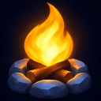
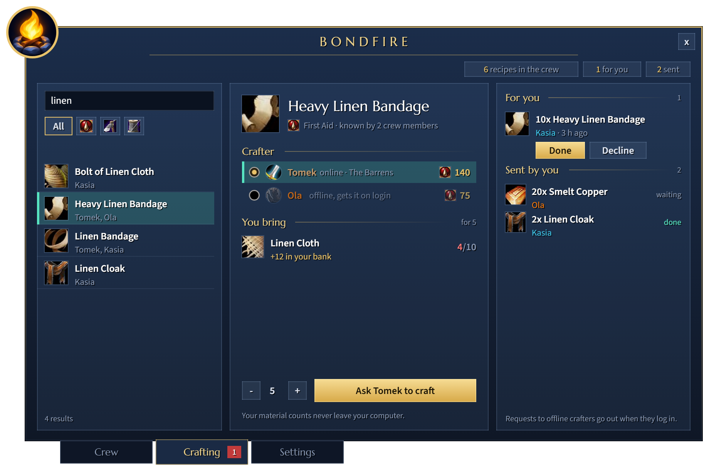
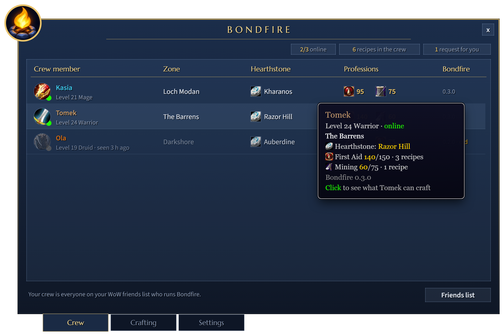
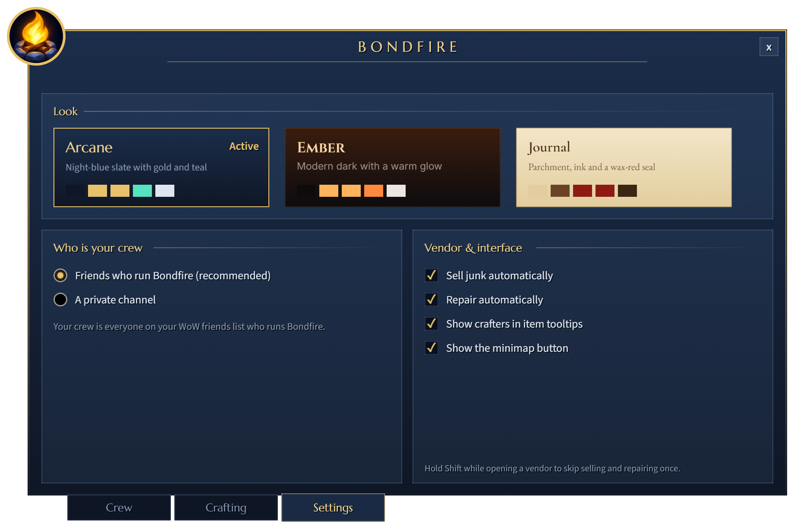
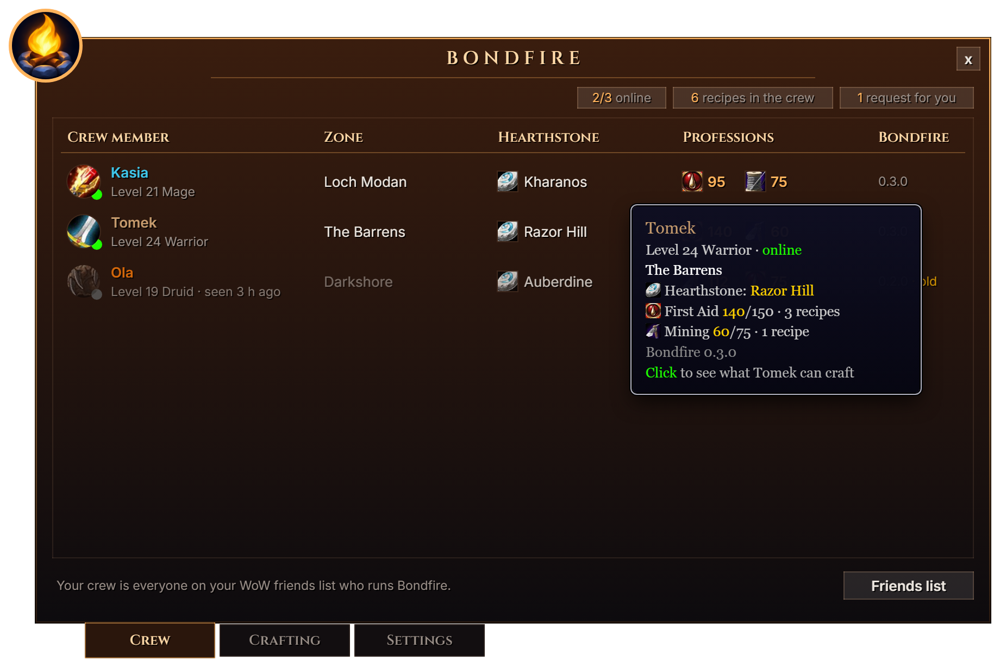
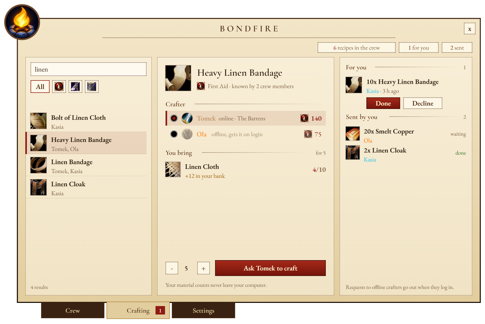

<p align="center">
  
</p>
<h1 align="center">Bondfire</h1>
<p align="center"><strong>Your crew's skills, one click away.</strong><br>A WoW Forever addon for friends who play together: shared professions, craft requests and hearthstones.</p>
<p align="center">
  
  
  
</p>
<p align="center"><a href="#install"><strong>Install with WowUp</strong></a> · <a href="https://github.com/kubaul/bondfire-release/releases/latest">Latest release</a> · <a href="https://github.com/kubaul/bondfire-release/issues">Report an issue</a></p>


<p align="center"><sub>Screenshots are rendered from the addon's own code in a test harness, ahead of the WoW Forever launch.</sub></p>

## Everything your crew can do, in one window

Open Bondfire from the minimap button. Find who can craft what, ask them for it, and see where everyone is, without typing a single command.

| | What you can do |
| :--- | :--- |
| 🔎 **Find a crafter** | Type three letters to search every recipe your crew knows. Shift-click an item in chat or in your bags to search for it. |
| 📜 **Ask for a craft** | Pick a crafter, set the amount and send the request. Bondfire shows which materials to bring; your counts stay on your computer. |
| ✉️ **Never miss a request** | Requests to offline crafters wait and go out when they log in. Mark requests for you as done or declined. |
| 🧭 **See your crew** | Class, level, zone, hearthstone, professions with skill points, and who is online right now. |
| 🏷️ **Know who makes it** | Item tooltips anywhere in the game show which crew members can craft the item. |
| 💰 **Skip vendor chores** | Junk is sold and gear repaired with your own gold when you open a vendor. Hold Shift to skip once. |

<table><tr>
<td width="50%" valign="top"><strong>Your crew at a glance</strong><br><br><p>Hover anyone for details. Click a row to see what they can craft.</p></td>
<td width="50%" valign="top"><strong>Set up from the window</strong><br><br><p>Choose who your crew is, how the vendor behaves and how Bondfire looks.</p></td>
</tr></table>

## Make it yours

Switch between **Arcane**, **Ember** and **Journal** in Settings. Each style has its own colors and fonts, and the change applies right away.

<table><tr>
<td width="50%" valign="top"><strong>Ember</strong><br><br></td>
<td width="50%" valign="top"><strong>Journal</strong><br><br></td>
</tr></table>

## No guild needed

Your crew is everyone on your WoW friends list who runs Bondfire. It is enough that one of you has the other as a friend. Bondfire talks through addon whispers, so friends without the addon see nothing.

Prefer not to use the friends list? Pick **A private channel** in Settings and share the channel name and password with your crew.

## Install

1. Install [WowUp](https://wowup.io) **2.24.1 or newer**, the first version that supports WoW Forever.
2. In WowUp, select **World of Warcraft: Forever** at the top.
3. Open **Get Addons → Install from URL** and paste:
   ```
   https://github.com/kubaul/bondfire-release
   ```
4. Start the game and click the Bondfire button at the minimap, or type `/bf`.

Everyone in your crew needs Bondfire. Open each of your profession windows once so the crew can see your recipes.

Blizzard does not let Trial and Veteran accounts send addon messages, so those players can see the crew but cannot share their own data.

**Without WowUp:** download `Bondfire-<version>-forever.zip` from the [latest release](https://github.com/kubaul/bondfire-release/releases/latest) and unzip it into `World of Warcraft\_forever_\Interface\AddOns`.

## Updates and privacy

WowUp checks this repository for new releases and updates Bondfire along with your other addons. In game, Bondfire also tells you when someone in your crew runs a newer version.

Bondfire never sends other players what you own: no bags, bank, gold or material counts. It shares what you can do (professions and recipes), what you ask for (craft requests) and where you are (class, level, zone and hearthstone), and only with friends who run Bondfire. There is no server, account or analytics. Messages travel through the game's own addon channel.

## License and support

This repository contains official downloads, documentation and artwork. The source code is maintained privately.

Bondfire bundles the Cinzel, Cormorant Garamond, EB Garamond, Inter, Marcellus and Source Sans 3 fonts under the SIL Open Font License. The license texts ship in `Bondfire/Media/Fonts`. Game icons shown in the screenshots belong to Blizzard Entertainment.

[Report a bug or suggest a feature](https://github.com/kubaul/bondfire-release/issues). Include your Bondfire version (type `/bf version` in game), the steps that lead to the problem, and a screenshot if helpful.
